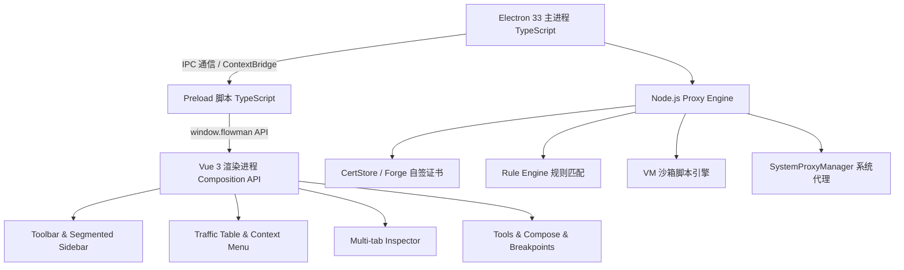

# Flowman

本地 HTTP/HTTPS 抓包与调试代理工具。基于 **Vue 3 + TypeScript + Vite + Electron** 现代化技术架构重构实现，界面与功能按 macOS 原生抓包工具 Proxyman 6.3.0 深度对齐。

---

## 技术架构



- **前端架构**：Vue 3.5 (Composition API, `<script setup lang="ts">`) + TypeScript 5.7 + Vite 8
- **桌面壳层**：Electron 33 + `vite-plugin-electron` 模块化双向构建 + 严格 Context Isolation
- **网络引擎**：基于 Node.js 原生 `http` / `https` / `net` / `tls` / `node-forge` 的高性能 MITM 代理
- **界面风格**：深度还原 Proxyman 6.3.0 视觉风格，支持域名/应用分类分组、拖拽调整侧边栏与检查器尺寸、底部与右侧多向停靠。

---

## 快速开始

### 1. 本地启动开发环境 (支持 Vite 毫秒级热重载)

```bash
cd /Users/zhangyuzhu/Desktop/code/project/demo/flowman
npm run dev
```

### 2. 生产打包构建 (TypeScript 类型检查 + Vite 极速打包)

```bash
npm run build
```

构建产物输出至：
- `dist/`：Vue 3 前端静态页面产物
- `dist-electron/main/`：Electron 主进程产物
- `dist-electron/preload/`：Electron Preload 脚本产物

### 3. 运行自动化冒烟测试 (TypeScript 代理核心功能验证)

```bash
npm run smoke
```

自动化测试覆盖：
- HTTP 代理请求捕获与分析
- HTTPS MITM 中间人动态证书解密与流量回放
- Map Local 本地文件映射
- Block List 规则拦截与自定义状态码返回
- Allow List 规则放行过滤
- JavaScript 动态脚本改写 `onResponse`
- Breakpoint 断点拦截与请求修改放行
- HAR 导出数据完整性校验

---

## 核心功能特性

1. **抓包与流量分析**：
   - 监听本地端口（默认 `9001`，与 Clash Verge 等主流代理端口冲突时自动顺延）。
   - 捕获完整 HTTP/HTTPS 请求与响应（支持 WebSocket 握手标头、CONNECT 隧道与 SSL 握手异常捕获）。
   - 域名树与应用分组视图，支持置顶固定（Pin）、一键开启 SSL 解密。
   - 8 种高亮颜色标记与删除线标记。
2. **多标签页检查器 (Inspector)**：
   - 概览 (Summary)、请求 (Request)、响应 (Response)、请求头 (Headers)、Body 对比、Cookies 解析、耗时分析 (Timing)、复制 cURL 命令。
   - 支持停靠到右侧或停靠到底部，拖拽实时调整比例并持久化记忆。
3. **12 项高级网络调试工具**：
   - **代理设置**：端口配置、系统代理一键接管、证书生成。
   - **SSL 解密**：按域名通配符白名单解密，支持忽略上游无效证书。
   - **断点调试**：请求前或响应后实时挂起，弹窗修改 Header 和 Body。
   - **Map Local**：将 API 请求映射到本地 Mock JSON 或文件。
   - **Map Remote**：将线上请求静默重定向到开发环境或本地端口。
   - **允许列表 / 阻止列表**：白名单与黑名单精确控制。
   - **脚本引擎**：在 VM 沙箱中编写 JavaScript 脚本自由修改数据流。
   - **反向代理 / 外部前置代理**：链式上游代理支持。
   - **网络限速**：人工注入延迟与带宽模拟。
4. **请求构建器 (Compose)**：
   - 自由构建任意 HTTP/HTTPS 请求，支持一键从抓包记录导入并重新发送。
5. **受控调试浏览器**：
   - 内置免配置受控 Chromium 浏览器窗口，自动挂载代理与自签 CA。
